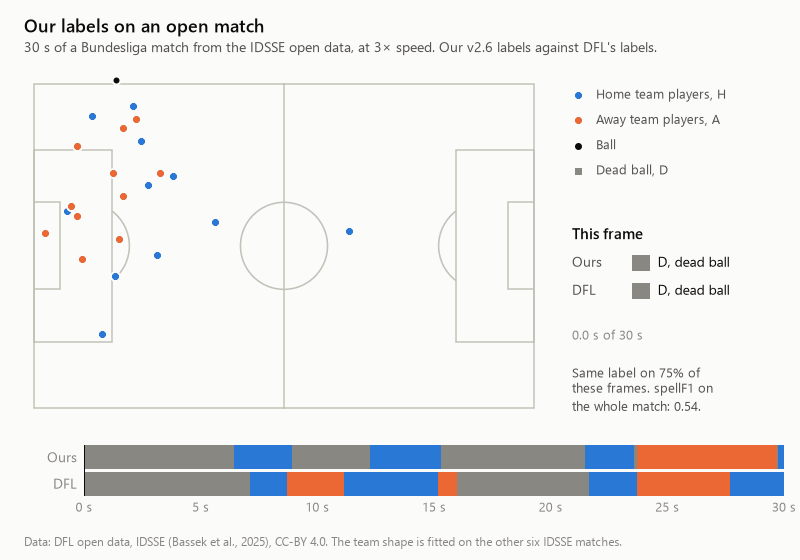

# KaburAjaDulu — More than a Hack 2027

Team **KaburAjaDulu**'s entry to [More than a Hack 2027](https://github.com/metrica-sports/more-than-a-hack-2027),
Phase 1. For each frame of a full LaLiga match, our code says which team has the ball.

This repository holds the code that builds our submitted file, and our technical document. It
does not hold the match data.

<picture>
  <source media="(prefers-color-scheme: dark)" srcset="docs/figures/showcase-dark.gif">
  
</picture>

The animation shows our method on 30 s of an open Bundesliga match (IDSSE, CC-BY 4.0), at 3×
speed. The top strip shows our labels. The bottom strip shows DFL's labels. The team shape is
fitted on the other six IDSSE matches, so this match is held out. Our own match is not shown,
because its data is not public.

## Results

| | |
|---|---|
| **Match** | FC Barcelona (home, `H`) vs Athletic Club (away, `A`), LaLiga 2024-25, matchday 2 |
| **Submitted file** | `output/KaburAjaDulu.csv`: `frame,label`, 199,319 rows, labels `H`, `A`, `D` (dead ball), `X` (not graded). Version v2.6, SHA-256 `e5c492ee245cfeae92a2f1384cbb8f6a436982f6514bcde4cd3cc3112b9db95d` |
| **Ranked on** | `spellF1` on the private full-match ground truth. `macroF1` breaks ties. |

| Test | spellF1 | Notes |
|---|---|---|
| IDSSE, 7 Bundesliga matches, each held out, ball gaps like ours | 0.512 | 0.493 with our kind of tracking noise |
| IDSSE, ball gaps in stoppages | 0.586 | 0.563 with our kind of tracking noise |
| Metrica Sample Games 1, 2 and 3 | 0.636, 0.642, 0.676 | labels from event data |
| **Public 5 minutes of our match** | **0.7467** | macroF1 0.9128; bootstrap 5–95%: 0.55–0.90 |
| Organisers' baseline, public 5 minutes | 0.3256 | macroF1 0.6207 |

The public 5 minutes hold only 17 possessions. That check shows that the pipeline is correct. It
cannot rank methods. On the full match, our file has 248 possessions with a mean of 14.0 s, and
dead ball on 45.4% of the graded frames.

## Reproduce the submission

**1. Install** Python 3.13 and the pinned packages:

```bash
python -m venv .venv
.venv/Scripts/python -m pip install -r requirements.txt     # Windows
# .venv/bin/python -m pip install -r requirements.txt       # macOS / Linux
```

**2. Get the data.** The match data is gated. It is **not** in this repository. Unpack the bundle
from the organisers so that the tactical files are in `data/tactical/`:

```
data/
└─ tactical/
   ├─ BAR-ATH_tactical_atd.xml
   ├─ BAR-ATH_tactical_atd.txt
   └─ ...
```

You can also keep the data in a different folder. Then pass `--data <folder>` or set
`MTAH_DATA_DIR`.

**3. Run** this command. It builds the submitted file again, byte for byte, in about 10 s:

```bash
.venv/Scripts/python -m kaburajadulu.run                    # macOS / Linux: .venv/bin/python
```

The command writes `output/KaburAjaDulu.csv`. It prints the label counts, the dead-ball share and
the number of possessions. No manual step is involved.

**4. Check the file.** Its SHA-256 must be the one in the Results table:

```bash
sha256sum output/KaburAjaDulu.csv           # Windows PowerShell: Get-FileHash output/KaburAjaDulu.csv
```

To validate the file, clone the [organisers' repository](https://github.com/metrica-sports/more-than-a-hack-2027)
next to this one and run its validator:

```bash
python ../more-than-a-hack-2027/evaluation/validate_submission.py output/KaburAjaDulu.csv
```

## Method

The full method is in the technical document, [docs/KaburAjaDulu.md](docs/KaburAjaDulu.md),
submitted as `KaburAjaDulu.pdf`. In short:

1. **Clean the tracking.** Automatic fixes only, the same on every match (`cleaning.py`).
2. **Read the evidence frame by frame.** Each clue gives a cost to the labels that it argues
   against: ball control and touches, the team shape, the ball out of play, set-piece shapes, the
   wait for the restart kick after a goal line, and the pace of play (`evidence.py`, `shape.py`,
   `setpieces.py`, `restarts.py`).
3. **Segment each half.** A Viterbi search finds the cheapest sequence of labels, with a price for
   each change of label. So the output is whole possessions, not single frames (`segment.py`).

No label comes from the competition match. The settings were chosen on open data: seven IDSSE
Bundesliga matches and three Metrica sample matches.

| File | What it does |
|---|---|
| `kaburajadulu/run.py` | the build command |
| `kaburajadulu/config.py` | match constants and data paths |
| `kaburajadulu/data.py` | loads the tactical tracking and the Smart Tagging |
| `kaburajadulu/cleaning.py` | automatic fixes to the tracking |
| `kaburajadulu/evidence.py` | per-frame evidence for `H`, `A` and `D`, written as costs |
| `kaburajadulu/shape.py` | the team shape: who has the ball, read from the players alone |
| `kaburajadulu/setpieces.py` | set-piece shapes as dead-ball evidence |
| `kaburajadulu/restarts.py` | the wait for the restart kick after a goal line |
| `kaburajadulu/segment.py` | the Viterbi segmentation |
| `kaburajadulu/model.py` | puts the parts together into the labels |
| `kaburajadulu/params.py` | every setting, with where its value comes from |
| `kaburajadulu/submission.py` | writes and checks the submission file |

The comments in the code name research scripts and notes (`scripts/`, `docs/`) from our
development repository. They are not needed to build the file, so they are not in this
repository. We share them with the organisers on request.

## Data and licences

| Data | Source and licence | Used for |
|---|---|---|
| Competition match | organisers' bundle (gated, not in this repository) | the submission |
| IDSSE, 7 Bundesliga matches | DFL open data, Bassek et al. (2025), *Scientific Data*; CC-BY 4.0 | team-shape fit; calibrations; the animation |
| Metrica Sample Games 1–3 | [metrica-sports/sample-data](https://github.com/metrica-sports/sample-data) | dead-ball check; price calibration |

The code is **not** open source. All rights are reserved; see [LICENSE](LICENSE). You may view
and run it only to evaluate or reproduce our competition entry.

## Team

Team **KaburAjaDulu**:

- Muhammad Brian Subekti
- Bastian Adiputra Siregar
- Palastha Zhorif Kawiswara
- Rajendra Rifqi Baskara
